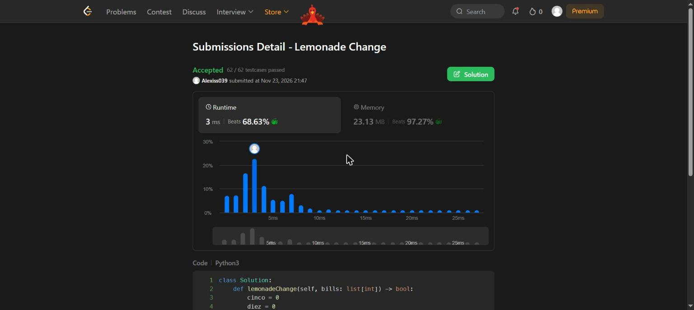
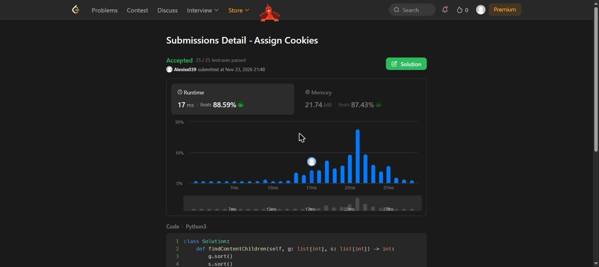

# Tarea 1 · Algoritmos greedy en LeetCode

Lenguaje: Python 3.

---

## 860. Lemonade Change

- Problema: https://leetcode.com/problems/lemonade-change/
- Código: [lemonade-change/solution.py](lemonade-change/solution.py)

**Criterio greedy.** Se atiende a los clientes en orden y solo se guarda cuántos billetes de 5 y de 10 hay en caja (el de 20 nunca sirve para dar vuelto).

- Con un billete de 5 no hay vuelto.
- Con uno de 10 se devuelve un 5.
- Con uno de 20 hay que devolver 15. Se prefiere **10 + 5** y solo si no hay se usan **5 + 5 + 5**.

Por qué: el billete de 5 es el más útil porque sirve para dar vuelto tanto a los clientes de 10 como a los de 20, mientras que el de 10 solo sirve para los de 20. Gastar primero el 10 deja la mayor cantidad posible de billetes de 5 para los clientes que vengan después. La decisión es local y no se deshace. Si en algún momento no se puede dar el vuelto, la respuesta es `false`.

**Complejidad.** Tiempo `O(n)`, una sola pasada por los `n` clientes. Espacio `O(1)`, dos contadores.

---

## 455. Assign Cookies

- Problema: https://leetcode.com/problems/assign-cookies/
- Código: [assign-cookies/solution.py](assign-cookies/solution.py)

**Criterio greedy.** Se ordenan los niños por gula `g` y las galletas por tamaño `s`, ambos de menor a mayor. Se recorren las galletas con un puntero y se lleva otro puntero sobre el niño menos exigente que aún no tiene galleta.

- Si la galleta alcanza para ese niño (`s[j] >= g[i]`), se le da y se avanza al siguiente niño.
- Si no alcanza, la galleta se descarta y se prueba la siguiente, más grande.

Por qué: cada niño recibe la **galleta más pequeña que lo satisface**. Así no se desperdicia una galleta grande en un niño fácil de contentar, y las grandes quedan para los más exigentes. La respuesta es el número de niños atendidos.

**Complejidad.** Tiempo `O(n log n + m log m)`, dominado por los dos ordenamientos (`n` niños, `m` galletas); la pasada con dos punteros es `O(n + m)`. Espacio `O(1)` adicional, sin contar el espacio que usa el ordenamiento (`O(log n + log m)` en Python al ordenar en el sitio).

