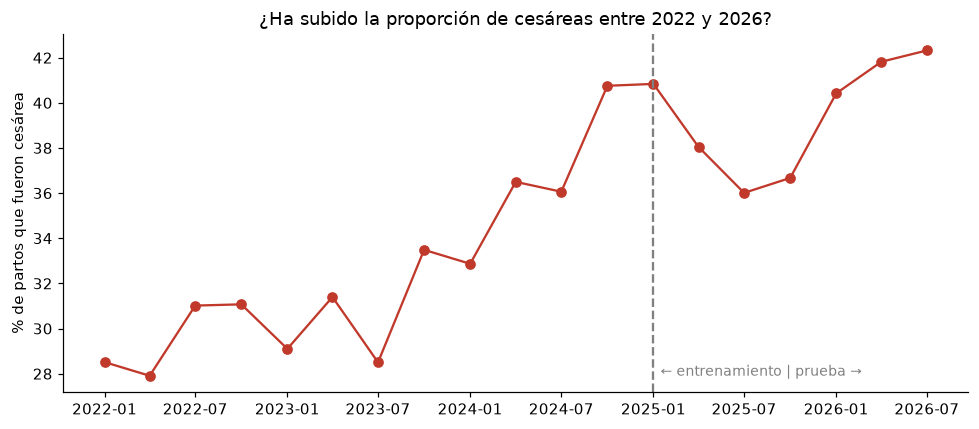
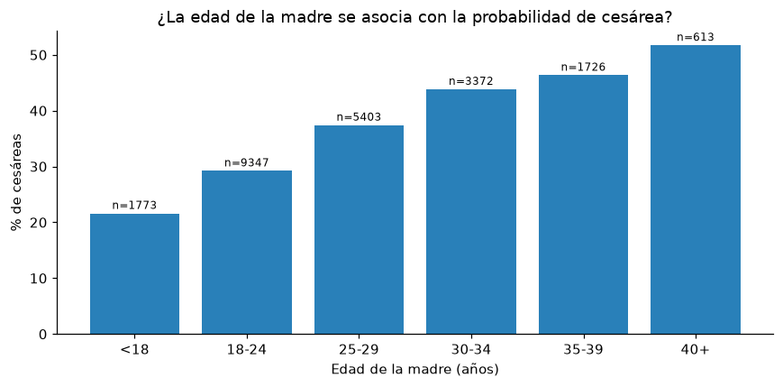
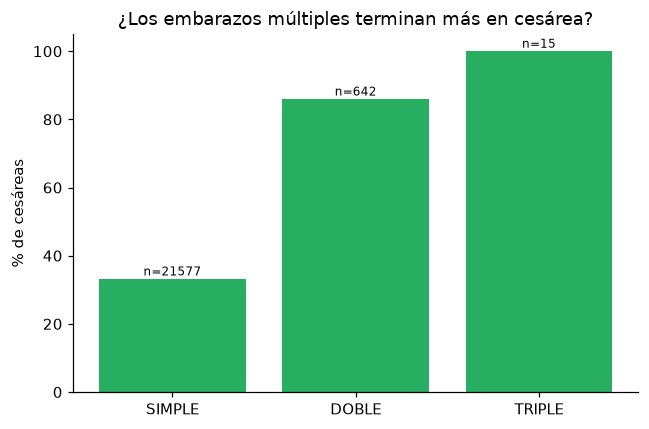
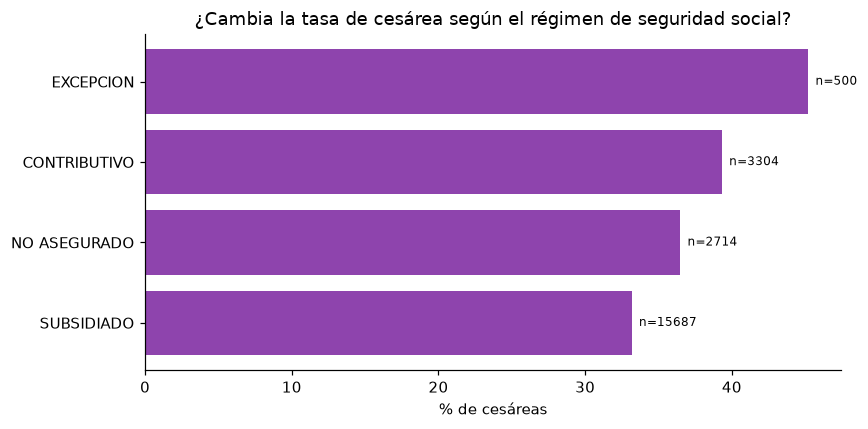
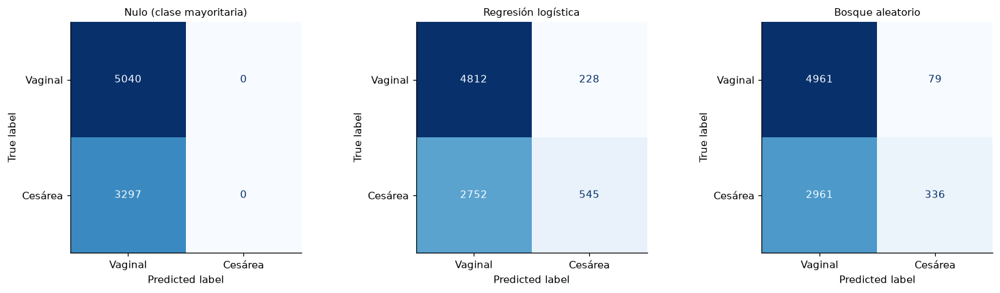
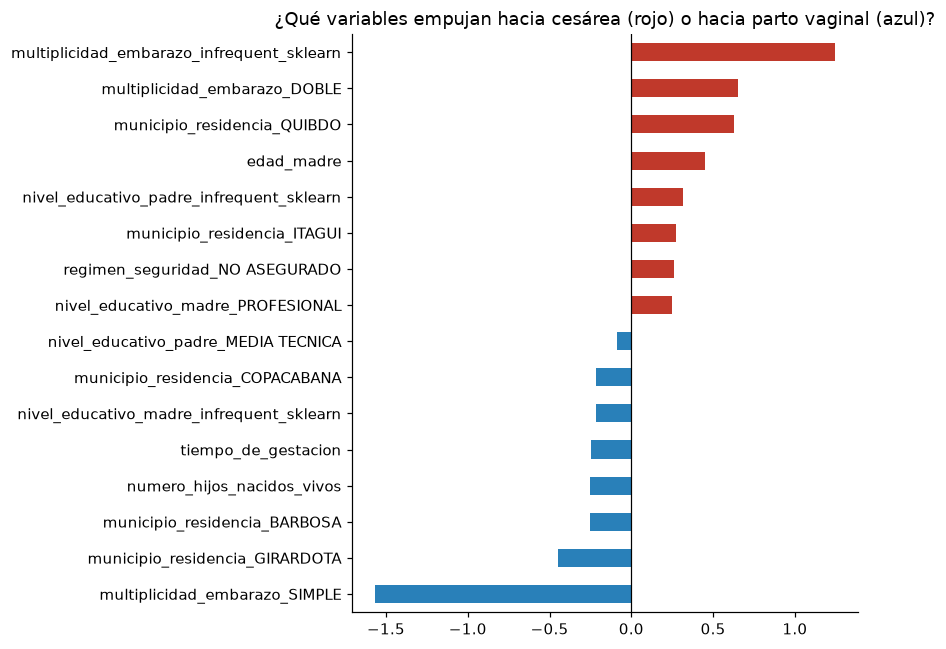

# Tarea 2 · Primer análisis en Google Colab

## Tarea 2

**URL del Colab:** <https://colab.research.google.com/drive/1cfI8UMxTzCaQhO6lhiJ0zZa06pUXgIvj?usp=sharing>

Notebook (copia local, ya ejecutado): [analisis-nacimientos/tarea2-analisis.ipynb](analisis-nacimientos/tarea2-analisis.ipynb)

> Compartido con `alejandro.salgar@gmail.com` como **Lector** y con "Cualquiera con el enlace" como **Lector**.

---

## Dataset

- **Nombre:** Nacimientos ocurridos en el Hospital General de Medellín.
- **Fuente:** datos.gov.co, <https://www.datos.gov.co/d/kjs7-2ryw>.
- **Tamaño después de leer:** 22 234 filas y 32 columnas (enero de 2022 a septiembre de 2026). Un registro es un nacimiento.
- **Lectura:** directo desde la API pública (`$limit=50000`), sin subir archivos ni rutas locales. El CSV no se redistribuye en este repositorio.

## Problema

Dadas las características de la madre, del embarazo y de su aseguramiento, anticipar si el parto terminó en **cesárea**.

- **y:** `y_cesarea = 1` si `tipo_parto` es cesárea, `0` si es espontáneo o instrumentado.
- **X:** edad de la madre y del padre, semanas de gestación, consultas prenatales, número de embarazos e hijos, multiplicidad, estado civil, nivel educativo, régimen de seguridad, área y municipio de residencia.
- **Fuera por filtración:** peso, talla y Apgar (se miden después del parto), quién atendió el parto y el certificador.
- **Split:** temporal. Entrenamiento 2022–2024, prueba 2025–2026.
- **Baseline:** clase mayoritaria del entrenamiento (parto no cesárea).

## Limpieza (resumen)

| Problema encontrado | Decisión |
| --- | --- |
| Misma categoría con y sin tilde (`CESAREA` / `CESÁREA`) | quitar tildes y pasar a mayúsculas en todo el texto |
| `estado_conyugal_madre` con redacción distinta entre periodos (13 valores) | mapeo a 6 categorías comparables |
| `SIN INFORMACION` como categoría | pasa a `NaN` |
| `edad_padre` de 94, 99 y 100 años | 3 valores a `NaN` |
| Paridad inconsistente (133 casos) | se marca, no se borra |
| `localidad` con 26 % de faltantes (hueco estructural) | no se usa ni se imputa |
| Faltantes menores en X | se imputan **dentro del Pipeline** con estadísticos del entrenamiento |
| Atípicos (madres de 12–14 años, prematuros extremos) | se conservan |

No se eliminó ninguna fila. Las decisiones completas están en las celdas del notebook.

## Gráficos (títulos en forma de pregunta)

**¿Ha subido la proporción de cesáreas entre 2022 y 2026?**



**¿La edad de la madre se asocia con la probabilidad de cesárea?**



**¿Los embarazos múltiples terminan más en cesárea?**



**¿Cambia la tasa de cesárea según el régimen de seguridad social?**



## Resultados en la prueba (2025–2026)

| Modelo | Exactitud | Recall cesárea | F1 cesárea | AUC |
| --- | --- | --- | --- | --- |
| Nulo (siempre parto vaginal) | 0,605 | 0,00 | 0,00 | 0,50 |
| Regresión logística | 0,643 | 0,17 | 0,27 | 0,65 |
| Bosque aleatorio | 0,635 | 0,10 | 0,18 | 0,66 |




**Lectura:** el modelo le gana al nulo, pero por poco (AUC 0,65). El patrón es coherente con el dominio (embarazo múltiple y mayor edad materna, más cesárea) y bajando el umbral a 0,3 el recall sube a 0,64. No se puede concluir que sirva para decisiones individuales: las indicaciones clínicas no están en la base, y los datos son de un solo hospital de referencia.

---

## Estructura

```text
tarea2/
├── README.md
├── analisis-nacimientos/
│   └── tarea2-analisis.ipynb
└── evidencias/
    └── (gráficos exportados del notebook)
```
